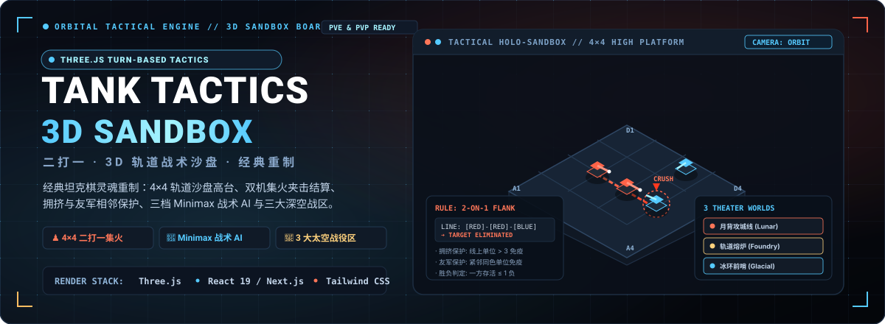
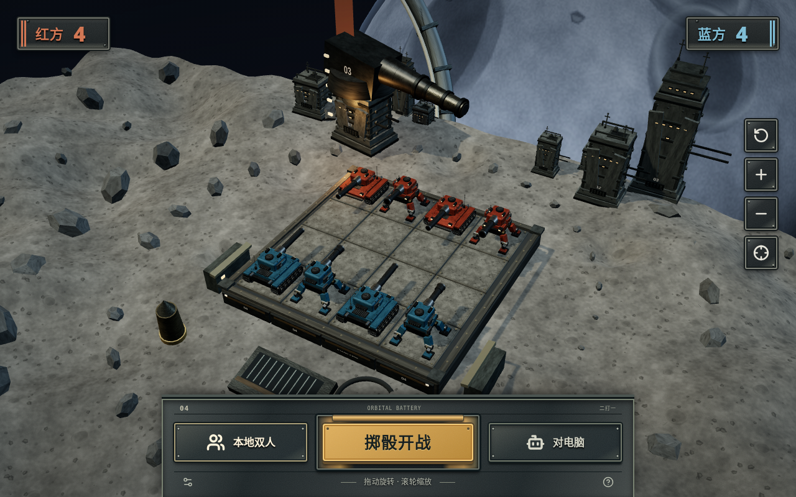
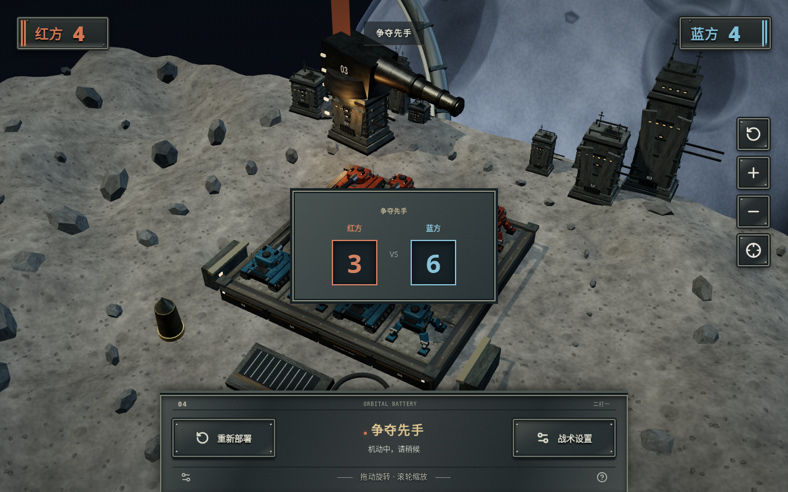

<p align="right"><a href="README.md">中文</a></p>

<p align="center">
  
</p>

<p align="center">
  <a href="https://holynova.github.io/tank-tactics-3d/">▶ Play Online</a>
  ·
  <a href="https://github.com/holynova/tank-tactics-3d">GitHub Repository</a>
</p>

Tank Tactics 3D is a Three.js remake of the classic "two-on-one" tank tactics game: on a 4×4 metal deck, Red and Blue field 4 units each; when two of your units line up with one enemy in three consecutive cells, the enemy is destroyed by crossfire. Reduce the enemy to a single unit to win. Three deep-space theaters, a 3-level Minimax AI, orbit camera and synthesized Web Audio sound, mobile-first.

## Screenshots

<p align="center">
  
  
</p>

## How to Play

- **Opening dice roll**: each side rolls one 1–6 die; the higher roll moves first; ties re-roll.
- **Move**: each turn, move one of your units 1 cell to an orthogonally adjacent empty cell; no diagonal moves, jumps, or occupied cells.
- **Two-on-one focus fire**: after landing, only the unit's row and column are scanned. Three consecutive cells reading `[me][me][foe]` or `[foe][me][me]` destroy the outermost enemy; rows and columns resolve independently, so one move can trigger a cross-shaped double focus fire.
  - **Crowding protection**: a line with more than 3 surviving units (all 4 cells filled) is exempt from focus fire.
  - **Friendly adjacency protection**: a threatened enemy adjacent to a friendly unit of the same color is spared.
- **Winning**: a side with ≤ 1 surviving unit loses.
- **Camera**: drag to orbit 360°, scroll / pinch to zoom, `+` / `−` / `⟲` for quick zoom and view reset.

## Modes & Content

- **Local 2-player**: pass-and-play on one screen; **vs computer**: the computer plays Red, you play Blue, with three Minimax difficulties — 简单 Easy (depth 1), 标准 Standard (depth 2), 困难 Hard (depth 3 with crowding-protection anticipation). The AI follows exactly the same movement rules as the player — no peeking, no stat bonuses.
- **Three theaters**: 月背攻城线 Lunar Siege Line (熔核炮队 Molten Core Battery vs 寒光炮队 Frostlight Battery), 轨道熔炉 Orbital Foundry (赤星炮队 Red Star Battery vs 星港炮队 Starport Battery), 冰环前哨 Glacial Outpost (余烬重炮 Ember Heavy Guns vs 霜环重炮 Frostring Heavy Guns) — each with its own lighting, livery and particle atmosphere.
- **Impact feel**: aim wind-up, hard recoil with hydraulic reset, physical shells, muzzle pressure rings, rolling fireballs, double shock rings and 2.6 seconds of lingering smoke; scorch marks and debris persist until redeployment.
- **Sound**: fully synthesized Web Audio — servo turns, engine tracks, dice clatter, low-frequency cannon fire and explosion debris, with stereo panning and mute.

## Run Locally

```bash
npm ci
npm run dev
# Tests (vitest, 29 cases, all passing)
npm test
# Build the GitHub Pages static version
npm run build:pages
```

## Tech

- Three.js 0.186 (`@react-three/fiber` + `@react-three/drei`) + React 19 + Next.js 16 + Tailwind CSS 4; zero CDN dependencies.
- The rules engine is pure functions (`app/game/rules.ts`: movement / focus fire / protection checks), fully separated from rendering; the AI is Minimax with alpha-beta pruning (`app/game/ai.ts`).
- The rules are ported from the classic two-on-one tactics game [holynova/tank-tactics-game](https://github.com/holynova/tank-tactics-game); the presentation layer rebuilds the "immersive deck" as an industrial lunar heavy-artillery emplacement.
- Art and asset licensing is documented in `ASSET_LICENSES.md`.

```
app/components/scene/   Three.js 3D: board / unit models / deck / theater environments / industrial materials
app/components/TacticalGame.tsx   Main flow, state controller and mobile HUD
app/game/           Pure-function rules engine: rules / ai / themes / audio / use-game-controller
github-pages/       Pages static-version entry (vite.pages.config.ts)
```
