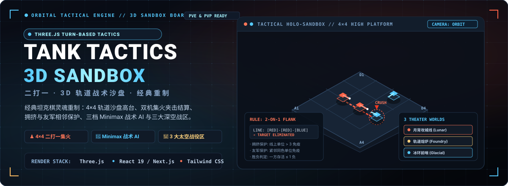
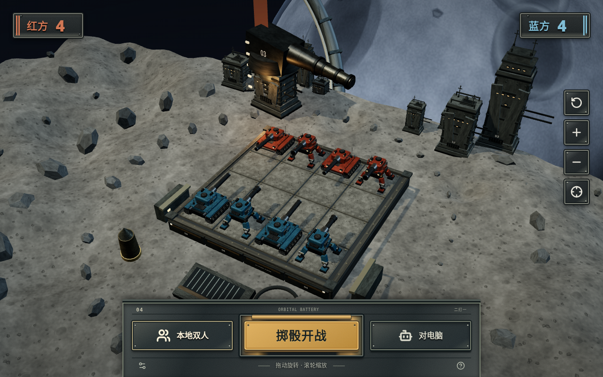
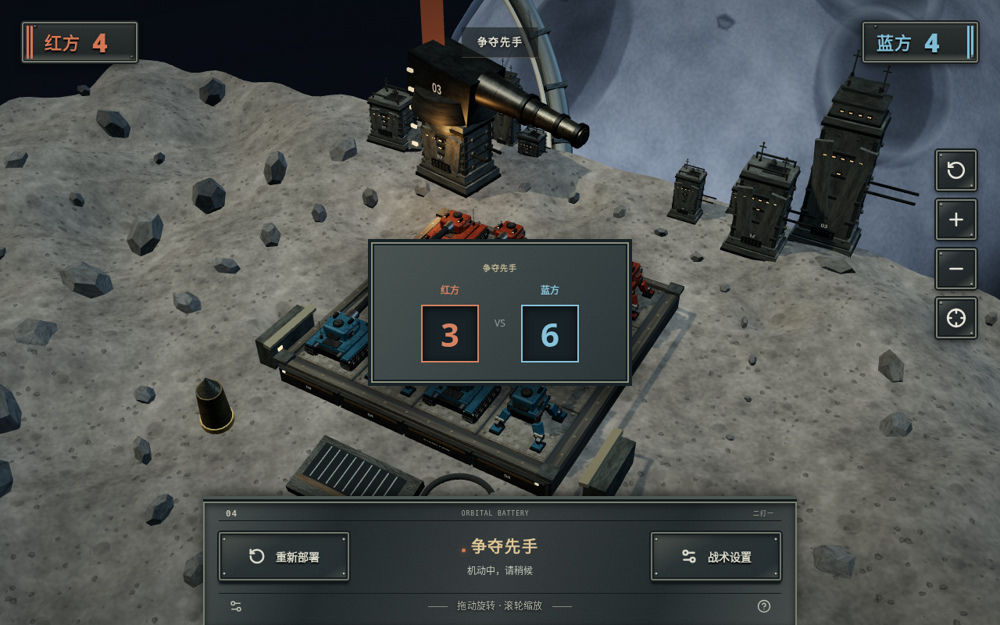

<p align="center">
  
</p>

<p align="center">
  <a href="https://holynova.github.io/tank-tactics-3d/">▶ 在线玩 Play Online</a>
  ·
  <a href="https://github.com/holynova/tank-tactics-3d">GitHub 仓库</a>
</p>

二打一 · 3D 战术沙盘是经典「二打一」坦克棋的 Three.js 三维重制版：4×4 金属甲板上红蓝双方各 4 台战车轮流机动，两辆己方战车与一辆敌方战车连成三格，敌方即被交叉集火击毁。先把对方打到只剩 1 辆者获胜。三大深空战区、3 档 Minimax AI、轨道相机与 Web Audio 合成音效，移动端优先。

Tank Tactics 3D is a Three.js remake of the classic "two-on-one" tank tactics game: on a 4×4 metal deck, Red and Blue field 4 units each; when two of your units line up with one enemy in three consecutive cells, the enemy is destroyed by crossfire. Reduce the enemy to a single unit to win. Three deep-space theaters, a 3-level Minimax AI, orbit camera and synthesized Web Audio sound, mobile-first.

## 截图 / Screenshots

<p align="center">
  
  
</p>

## 玩法 / How to Play

- **先手掷骰**：开局双方各掷一枚 1–6 点骰子，点大者先动；平局重掷。
- **移动**：每回合选一台己方战车，向上下左右正交相邻的空格走 1 格；不能斜走、跳跃或进入占用格。
- **二打一集火**：落点后只扫描所在行与列。连续三格出现 `[我][我][敌]` 或 `[敌][我][我]`，最外侧的敌军即被击毁；行列独立结算，一次移动最多触发十字双向集火。
  - **拥挤保护**：某条线上存活单位超过 3 台（塞满 4 台）时，整条线豁免集火。
  - **友军相邻保护**：受威胁的敌军紧邻同色友军时，免于被歼灭。
- **胜负**：任一方存活战车数 ≤ 1 时判负。
- **相机**：拖拽旋转 360° 环视，滚轮 / 捏合缩放，`+` / `−` / `⟲` 快速缩放与复位视角。

## 模式与内容 / Modes & Content

- **本地双人**：同屏轮流执棋；**对电脑**：电脑执红方，你执蓝方，三档 Minimax AI——简单（1 层搜索）、标准（2 层）、困难（3 层 + 拥挤保护预判），AI 与玩家走子规则完全一致，无透视、无数值加成。
- **三大战区**：月背攻城线（熔核炮队 vs 寒光炮队）、轨道熔炉（赤星炮队 vs 星港炮队）、冰环前哨（余烬重炮 vs 霜环重炮），各有专属光影、涂装与粒子气氛。
- **打击表现**：蓄势瞄准、硬后坐与液压复位、实体炮弹、炮口压力环、滚动火团、双冲击环与 2.6 秒余烟；焦痕与碎块保留至重新部署。
- **音效**：Web Audio 全合成——伺服转向、引擎履带、骰子碰撞、低频炮声与爆炸碎片，支持左右声场与静音。

## 本地运行 / Run Locally

```bash
npm ci
npm run dev
# 测试（vitest，29 个用例全过）
npm test
# 构建 GitHub Pages 静态版
npm run build:pages
```

## 技术 / Tech

- Three.js 0.186（`@react-three/fiber` + `@react-three/drei`）+ React 19 + Next.js 16 + Tailwind CSS 4；零 CDN 外部依赖。
- 规则引擎是纯函数（`app/game/rules.ts`：走子 / 集火 / 保护判定），与渲染层完全分离；AI 是带 Alpha-Beta 剪枝的 Minimax（`app/game/ai.ts`）。
- 规则原案移植自经典二打一策略棋 [holynova/tank-tactics-game](https://github.com/holynova/tank-tactics-game)，表现层按「沉浸式甲板」重构为工业月面重炮阵地。

```
app/components/scene/   Three.js 3D：棋盘 / 单位模型 / 甲板 / 战区环境 / 工业材质
app/components/TacticalGame.tsx   主流程、状态控制器与移动端 HUD
app/game/           纯函数规则引擎：rules / ai / themes / audio / use-game-controller
github-pages/       Pages 静态版入口（vite.pages.config.ts）
```

## English

**Tank Tactics 3D** is a Three.js remake of the classic two-on-one tank tactics game. On a 4×4 deck, Red and Blue each field 4 units; move one unit per turn to an orthogonally adjacent empty cell. When two of your units end up in a line with an enemy (`[me][me][foe]` or `[foe][me][me]`), the outermost enemy is destroyed. Reduce the enemy to one unit to win.

- **Focus fire, with exceptions**: lines with 4 units are exempt (crowding immunity); an enemy adjacent to a friendly unit on the same line is shielded. Rows and columns resolve independently.
- **Modes**: local pass-and-play, or vs AI (computer plays Red). Three Minimax difficulties — Easy (depth 1), Standard (depth 2), Hard (depth 3 with crowding anticipation) — with no cheating: the AI follows the exact same rules.
- **Theaters**: Lunar Siege Line, Orbital Foundry, Glacial Outpost — each with its own lighting, livery and particle atmosphere.
- **Run it**: `npm ci && npm run dev`. Tests: `npm test` (vitest, 29 cases, all passing). Pages build: `npm run build:pages`.
- **Tech**: Three.js 0.186 + React 19 + Next.js 16 + Tailwind CSS 4. The rules engine is pure functions, fully separated from rendering.

## 许可 / License

仓库未附 LICENSE 文件；美术与素材许可见 `ASSET_LICENSES.md`。
